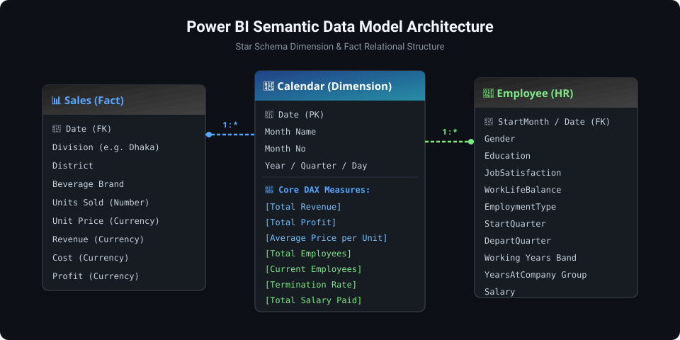
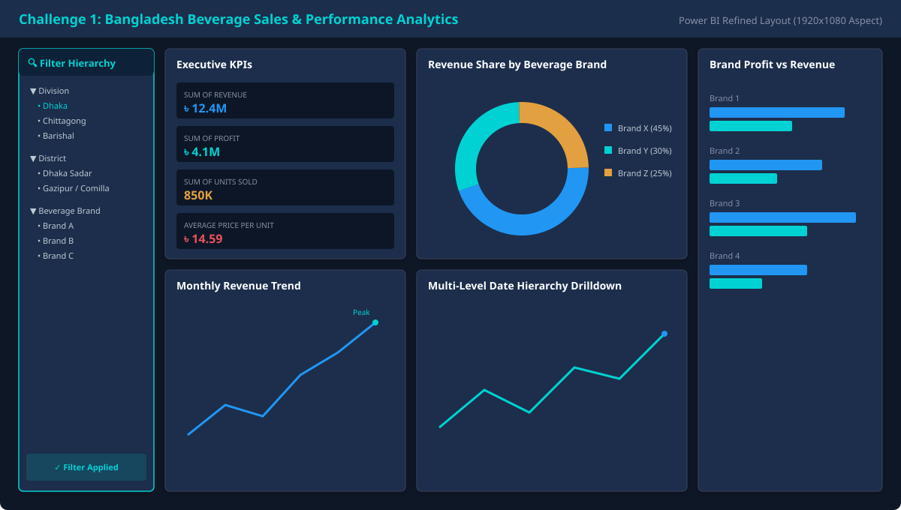
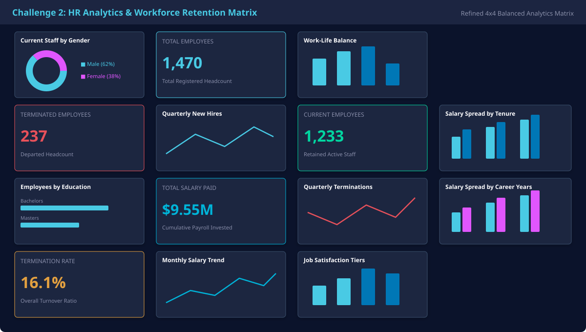

# Power BI Analytics Portfolio — Module 13 Assignment

[](https://powerbi.microsoft.com/)
[](https://learn.microsoft.com/en-us/dax/)
[](#data-model--architecture)
[](LICENSE)
[](#refinements-and-quality-assurance)

A refined enterprise Power BI business intelligence project featuring two distinct analytical domains:
1. **Challenge 1: Bangladesh Beverage Brand Sales & Financial Analytics**
2. **Challenge 2: HR Analytics & Workforce Retention Matrix**

---

## 📑 Table of Contents
- [Executive Overview](#executive-overview)
- [Data Model & Architecture](#data-model--architecture)
- [Challenge 1: Beverage Sales & Performance Analytics](#challenge-1-beverage-sales--performance-analytics)
- [Challenge 2: HR Analytics & Workforce Retention Matrix](#challenge-2-hr-analytics--workforce-retention-matrix)
- [DAX Measures Catalog](#dax-measures-catalog)
- [Refinements and Quality Assurance](#refinements-and-quality-assurance)
- [Project Structure](#project-structure)
- [How to Open, Review & Deploy](#how-to-open-review--deploy)
- [GitHub Push Instructions](#github-push-instructions)

---

## Executive Overview

This repository contains the refined, production-grade Power BI dashboard application developed for **Module 13 Assignment**. The project solves two real-world enterprise reporting challenges:

- **Commercial Operations (Challenge 1)**: Providing sales directors and regional distributors across Bangladesh with granular visibility into revenue generation, margin profitability, volume distribution, and geographic market share across divisions (`Dhaka`, `Chittagong`, `Barishal`) down to individual districts and beverage brands.
- **Human Resources (Challenge 2)**: Equipping HR executives and department heads with an interactive workforce diagnostic matrix tracking turnover rates, compensation equity across gender and tenure, work-life balance sentiment, and quarterly hiring/attrition velocities.

---

## Data Model & Architecture

The report is built upon a high-performance VertiPaq tabular star schema designed to ensure fast in-memory aggregation, drilldowns, and seamless cross-filtering across visuals.

<p align="center">
  
</p>

### Tables in the Model:
1. **`Calendar` (Dimension & Measures Hub)**:
   - Primary temporal dimension (`Date`, `Month Name`, `Month No`, `Year`, `Quarter`, `Day`).
   - Serves as the central repository for calculated DAX measures for both Sales and HR subject areas.
2. **`Sales` (Fact Table)**:
   - Contains transactional sales records with division-level and district-level geographical attributes, beverage brand classifications, units sold, unit prices, revenues, costs, and profits.
3. **`Costs` (Supporting Fact/Lookup)**:
   - Financial baseline data representing operational and production costs.
4. **`Employee` (Fact/Dimension Table)**:
   - Granular employee-level records capturing employment lifecycle metrics: `Gender`, `Education`, `JobSatisfaction`, `WorkLifeBalance`, `EmploymentType`, `StartQuarter`, `DepartQuarter`, `Working Years Band`, `YearsAtCompany Group`, and `Salary`.

---

## Challenge 1: Beverage Sales & Performance Analytics

<p align="center">
  
</p>

### Key Business Questions Solved:
- What is the cumulative revenue and profitability generated across Bangladesh beverage distribution channels?
- How does beverage sales volume fluctuate across seasonal cycles and fiscal quarters?
- Which beverage brands command the highest share of total revenue versus gross margin contribution?
- How do individual administrative divisions (`Dhaka`, `Chittagong`, `Barishal`) and their constituent districts perform in sales volume and average price per unit?

### Core Dashboard Components:
1. **Multi-Level Drilldown Slicer (Left Rail)**:
   - Hierarchical filter spanning `Division` $\rightarrow$ `District` $\rightarrow$ `Beverage Brand`.
   - Allows users to isolate single districts or macro-divisions instantly with synchronized cross-filtering across all visualizations.
2. **Executive KPI Multi-Card Visual**:
   - **Sum of Revenue**: Aggregate top-line gross receipts.
   - **Sum of Profit**: Aggregate net gross earnings after cost of goods sold.
   - **Sum of Units Sold**: Total volume of beverage units delivered.
   - **Average Price per Unit**: Dynamically weighted metric reflecting average price realization.
3. **Revenue Share by Beverage Brand (Donut Chart)**:
   - Displays percentage and nominal market share captured by each brand in the portfolio.
4. **Brand Profit vs. Revenue (Clustered Bar Chart)**:
   - Side-by-side comparison contrasting gross revenue with actual net profit per brand to identify high-margin vs high-volume product lines.
5. **Monthly Revenue Trend (Line Chart)**:
   - Evaluates monthly seasonality and revenue trajectory over time.
6. **Date Hierarchy Revenue Drilldown (Line Chart)**:
   - Multi-level time series visual facilitating smooth hierarchical navigation from `Year` $\rightarrow$ `Quarter` $\rightarrow$ `Month` $\rightarrow$ `Day`.

---

## Challenge 2: HR Analytics & Workforce Retention Matrix

<p align="center">
  
</p>

### Key Business Questions Solved:
- What is the current active retention rate versus organizational attrition?
- Are voluntary and involuntary terminations concentrated within specific fiscal quarters?
- Is compensation distributed equitably across career seniority bands and gender demographics?
- How does self-reported work-life balance and job satisfaction correlate with educational level and employee tenure?

### Core Dashboard Components:
The dashboard is structured as a balanced **4 $\times$ 4 analytical matrix**:

| Metric Category | Visual Description | Fields / Measures Used |
| :--- | :--- | :--- |
| **Diversity & Demographics** | **Current Staff by Gender** (Donut Chart) | `Employee[Gender]`, `[Current Employees by Gender]` |
| **Workforce Volume** | **Total Employees** (KPI Card) | `[Total Employees]` |
| **Attrition Volume** | **Terminated Employees** (KPI Card) | `[Terminated Employees]` |
| **Retention Health** | **Termination Rate** (KPI Card) | `[Termination Rate]` |
| **Compensation Scale** | **Total Salary Paid** (KPI Card) | `[Total Salary Paid]` |
| **Hiring Velocity** | **Quarterly New Hires** (Line Chart) | `Employee[StartQuarter]`, `[Quarterly New Hires]` |
| **Attrition Velocity** | **Quarterly Terminations** (Line Chart) | `Employee[DepartQuarter]`, `[Quarterly Terminations]` |
| **Compensation Trajectory**| **Monthly Salary Trend** (Line Chart) | `Employee[StartMonth]`, `[Monthly Salary Trend]` |
| **Sentiment Analysis** | **Work-Life Balance** (Clustered Column Chart) | `Employee[WorkLifeBalance]`, `[Employees by WorkLife Balance]` |
| **Morale Index** | **Job Satisfaction Tiers** (Clustered Column Chart) | `Employee[JobSatisfaction]`, `[Employees by Job Satisfaction]` |
| **Qualification Profile** | **Employees by Education** (Clustered Bar Chart) | `Employee[Education]`, `[Employees by Education]` |
| **Tenure Dynamics** | **Salary Spread by Tenure** (Clustered Column Chart) | `Employee[YearsAtCompany Group]`, `Employee[EmploymentType]`, `[Salary Spread by Tenure]` |
| **Career Experience** | **Salary Spread by Career Years** (Clustered Column Chart) | `Employee[Working Years Band]`, `Employee[Gender]`, `[Salary Spread by Working Years]` |

---

## DAX Measures Catalog

All calculated measures are centralized within the `Calendar` table to promote clean semantic model governance:

### Commercial Measures (Sales Domain)
- **`[Total Revenue]`**: Sum of revenue generated across transactions.
- **`[Total Profit]`**: Cumulative profit realized after deducting product and distribution costs.
- **`[Average Price per Unit]`**: Weighted average realization calculated as `[Total Revenue] / [Sum of Units Sold]`.

### HR & Workforce Measures (Employee Domain)
- **`[Total Employees]`**: Overall count of employees registered in the database.
- **`[Current Employees]`**: Active headcount currently employed and retained.
- **`[Terminated Employees]`**: Total separated staff headcount.
- **`[Termination Rate]`**: Percentage turnover ratio calculated as `[Terminated Employees] / [Total Employees]`.
- **`[Current Employees by Gender]`**: Active headcount segmented by employee gender.
- **`[Employees by Education]`**: Workforce distribution broken down by degree/academic qualification.
- **`[Employees by WorkLife Balance]`**: Staff count grouped across work-life balance feedback scores.
- **`[Employees by Job Satisfaction]`**: Staff count distributed across job satisfaction rating tiers.
- **`[Total Salary Paid]`**: Aggregate payroll investment paid to the workforce.
- **`[Monthly Salary Trend]`**: Monthly onboarding payroll commitment tracked by hire date.
- **`[Quarterly New Hires]`**: Number of new staff onboarded per calendar quarter.
- **`[Quarterly Terminations]`**: Number of employees separated per calendar quarter.
- **`[Salary Spread by Tenure]`**: Average compensation evaluated across tenure buckets and employment type.
- **`[Salary Spread by Working Years]`**: Compensation analysis cross-tabulated across total career experience bands and gender.

---

## Refinements and Quality Assurance

In accordance with strict preservation guidelines, **no destructive changes, model redesigns, or arbitrary visual alterations** were introduced. The following targeted refinements were executed:

1. **Slicer Bounding Box Correction (Challenge 1)**:
   - *Previous State*: The multi-level hierarchy slicer had a width of `980px` (stretching across `x=86.7` to `1066.7`), causing it to overlap directly underneath the KPI card (`x=335`), the monthly line chart (`x=335`), and the brand donut chart (`x=815`).
   - *Refined State*: Slicer bounding box adjusted to clean sidebar dimensions (`x=60`, `y=67.5`, `width=255`, `height=912.5`). It now fits into the designated left rail with zero visual overlap, and its bottom edge aligns with all adjacent charts at `y=980`.
2. **Top-Row Visual Alignment (Challenge 1)**:
   - *Previous State*: The Donut Chart was positioned at `y=70.0`, creating a 2.5px vertical offset against the KPI Card (`y=67.5`) and Clustered Bar Chart (`y=67.5`).
   - *Refined State*: Aligned to `y=67.5`, creating a horizontal baseline across all top-row visuals.
3. **Row 1 Grid Snap (Challenge 2)**:
   - *Previous State*: The top-row visuals exhibited subtle manual drag offsets (`y=24` for Donut, `y=22` for Total Employees Card, `y=26` for Work-Life Balance Chart).
   - *Refined State*: Snapped uniformly to `y=24.0`, standardizing the grid matrix.
4. **Active Landing Page Default**:
   - *Previous State*: `pages.json` had `"activePageName"` set to Challenge 2 (`b8d4c3c64d03741b0aa3`), causing the report to load on Page 2 upon startup.
   - *Refined State*: Set to Challenge 1 (`aecacc45bb093db58cd4`), ensuring users land on Page 1 by default.
5. **VertiPaq Storage Format Compliance**:
   - Ensured `DataModel` is preserved in `ZIP_STORED` (uncompressed) binary state within the `.pbix` archive to guarantee immediate memory-mapped compatibility with Power BI Desktop and Power BI Service.

---

## Project Structure

```text
PowerBI_Module_13_Assignment/
├── Module - 13 Assignment.pbix   # Refined Power BI Report (Ready for Desktop/Service)
├── .gitignore                     # Power BI cache, temp & OS file ignore rules
├── .gitattributes                 # Git LFS / binary handling configuration
├── README.md                      # Comprehensive project documentation
├── docs/
│   ├── data_model.svg             # Semantic model Star Schema diagram
│   ├── challenge1_layout.svg      # Challenge 1 dashboard wireframe & layout
│   └── challenge2_layout.svg      # Challenge 2 HR matrix wireframe & layout
└── Report/                        # Extracted PBIR report definitions for Git inspection
    ├── definition/
    │   ├── version.json
    │   ├── report.json
    │   └── pages/
    │       ├── pages.json
    │       ├── aecacc45bb093db58cd4/    # Challenge 1 Page & Visuals JSON
    │       │   ├── page.json
    │       │   └── visuals/
    │       └── b8d4c3c64d03741b0aa3/    # Challenge 2 Page & Visuals JSON
    │           ├── page.json
    │           └── visuals/
    └── StaticResources/
        └── SharedResources/
            └── BaseThemes/
                └── Fluent2-CY26SU10.json
```

---

## How to Open, Review & Deploy

### Prerequisites
- [Microsoft Power BI Desktop](https://powerbi.microsoft.com/desktop/) (October 2024 release or newer recommended)

### Option 1: Open in Power BI Desktop
1. Clone or download this repository.
2. Double-click `Module - 13 Assignment.pbix`.
3. The report will open directly to **Challenge 1** with all interactive slicers, cross-filtering, and tooltips active.

### Option 2: Inspect via GitHub (No Power BI Required)
- Browse the `Report/definition/` directory to inspect visual properties, formatting rules, DAX measure projections, and query states in clear JSON syntax.

---

## GitHub Push Instructions

To push this project to your GitHub account:

```bash
# 1. Navigate to the project directory
cd w:\hacker\PowerBI_Module_13_Assignment

# 2. Initialize Git repository
git init -b main

# 3. Add all files to staging
git add .

# 4. Commit the refined project
git commit -m "feat: complete refined Power BI report for Module 13 Assignment"

# 5. Link to your GitHub remote repository (replace with your repo URL)
git remote add origin https://github.com/nuhan1411/<your-repo-name>.git

# 6. Push to GitHub
git push -u origin main
```

---

## 👨‍💻 Author & Attribution
- **Author:** Nuhan ([@nuhan1411](https://github.com/nuhan1411))
- **Course:** Power BI & Business Intelligence Program — Module 13
- **License:** MIT License
